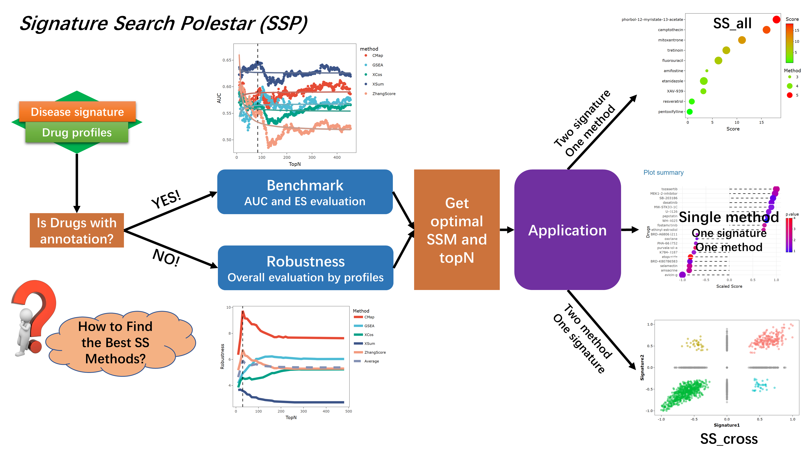

---
output:
  word_document: default
  html_document: default
---
### Why we built SSP2?
The burgeoning high-throughput technologies have led to a significant surge in the scale of **pharmacotranscriptomic datasets**, especially for oncology. **Signature search methods (SSMs)**, utilizing **query signatures** formed by differentially expressed genes (DEGs) through sequencing, have been instrumental in anti-cancer drug screening and identifying mechanisms of action without relying on prior knowledge.  
However, various studies have found that different SSMs exhibit varying performance across pharmacotranscriptomic datasets. In addition, truncating the query signature to different sizes can also significantly impact the results of drug repurposing. Therefore, **finding the optimal SSMs and customized query signature for a specific disease remains a challenge**.  
**Signature Search Polestar 2 (SSP2)** is a webserver integrating the largest uniform drug profiles in L1000 with seven state-of-the-art signature search methods (XSum, CMap, GSEA, ZhangScore, XCos, PLAGE, QuSAGE). It provides Benchmark and Application modules for compound datasets, and the Application additionally supports **CRISPR knockout (LINCS-CRISPR)** datasets in which the ranked entities are target genes:  
1.	Benchmark: five ranking-quality metrics (AUROC, AUPRC, Recall@K, EF@5% and ES) are evaluated against a label-permutation null to identify the best-performing SSM and the most suitable signature size for an input disease signature.  
2.	Application: Three tools (single method, SS_all, and SS_cross) enable user to utilize optimal SS methods with disease signatures. The results present scores of promising drug for query signature.  

Additionally, the SSP2 webserver is deployed at high performance servers for better user experience and the source code is open-sourced at [GitHub](https://github.com/AuPtZ/SSP2). A frozen archive of the SSP v1 (2024) release is available from [figshare](https://doi.org/10.6084/m9.figshare.26524741.v1).

#### Data provenance

SSP2 builds on three public pharmacotranscriptomic resources:

- **LINCS2020 beta** (CMap LINCS 2020 release, December 2020): Level-5 compound-treatment
  signatures, 720,216 signatures x 12,328 genes. The 12,328 genes are the 978 directly
  measured L1000 landmark genes plus computationally inferred genes. QC-passing signatures
  were grouped by cell line, dose and treatment time (6 h / 24 h) and averaged per compound,
  yielding profiles for 155 tumor cell lines. This is the final L1000 release; the CLUE data
  portal was retired on 2026-01-31 and the public data are archived at GEO.
- **Tahoe-100M**: single-cell perturbation profiles aggregated into pseudobulk
  differential-expression signatures (DESeq2 log2FC versus plate-matched DMSO controls).
  Conditions with fewer than 50 treated or control cells were excluded, as were three
  low-abundance cell lines. SSP2 provides 47 cell lines plus one pan-cell-line aggregate,
  each at three doses (0.05, 0.5, 5 uM) at a single 24 h time point, covering 379 drugs on
  62,710 genes.
- **LINCS-CRISPR (route B addition)**: Level-5 CRISPR knockout signatures from the
  LINCS2020 beta `level5_beta_trt_xpr` matrix (140,945 signatures; 5,158 target genes;
  27 cell lines; single 96 h time point). QC-passing signatures were averaged per target
  gene, yielding 19 cell lines x ~5,000 target genes. In the Application, these datasets
  rank **target genes** rather than compounds; an offline method/topN calibration from the
  SSP2 pilot is shown for each cell line.

File names, byte sizes, checksums, processing parameters and licence notes are documented
in the project `README.md`. All source resources should be cited when publishing results
obtained with SSP2.

