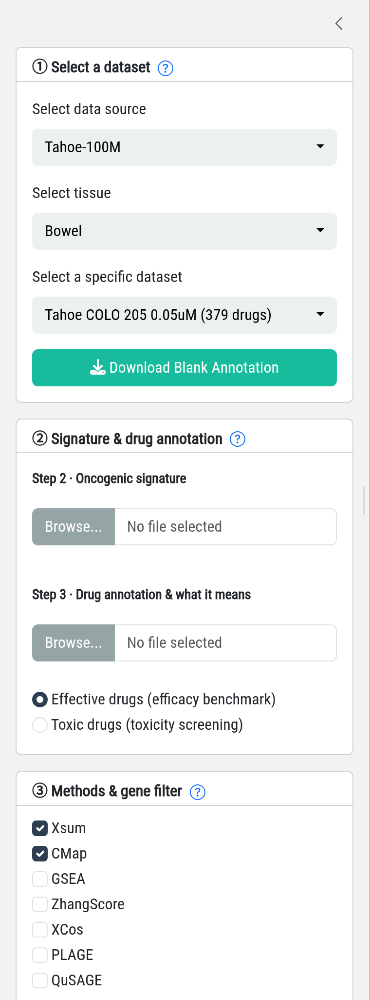
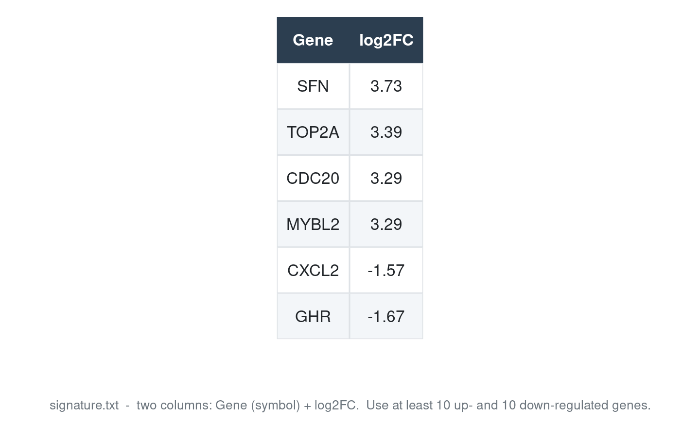
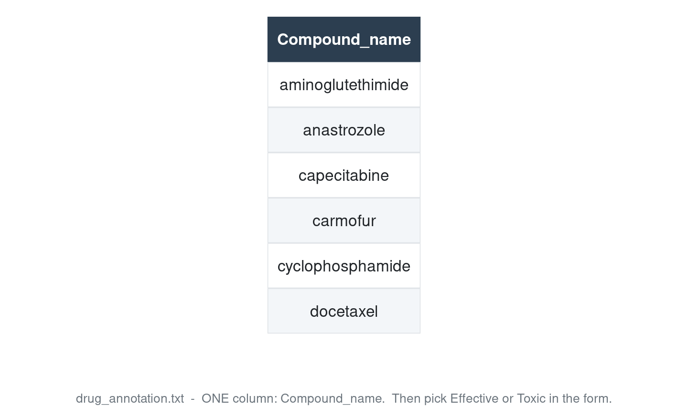
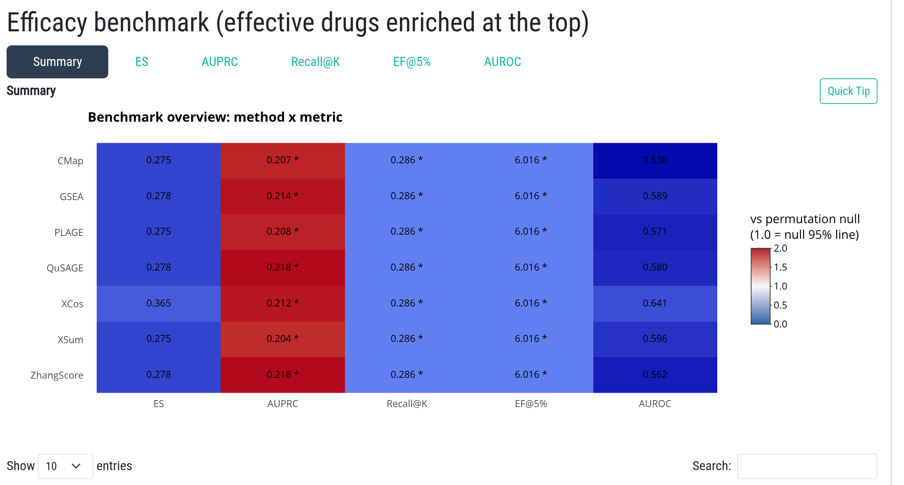
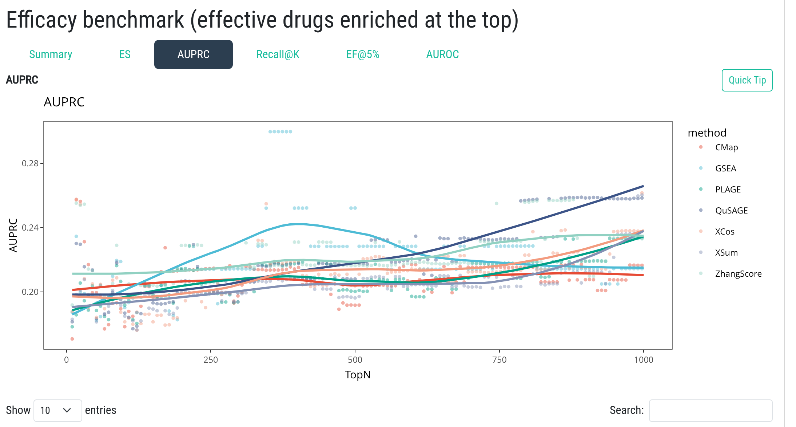

### How to use Benchmark and interpret the results?

The **Benchmark** module evaluates how well each **Signature Search Method (SSM)** retrieves a
set of known drugs from a pharmacotranscriptomic dataset, and how that performance changes
with the size of the query signature. Its output tells you **which method** and **which
gene number (topN)** work best for your own signature, so that the later drug query in the
**Application** module uses a calibrated setting rather than a guess.

#### Steps in the left panel

**Step 1 · Select a pharmacotranscriptomic dataset.** Choose a **data source**
(`LINCS` or `Tahoe-100M`), then a **tissue**, then a specific **dataset** (cell line, dose and
treatment time). LINCS2020 beta provides 155 tumor cell lines measured on 12,328 landmark
genes; Tahoe-100M provides 47 cell lines at three doses on 62,710 genes (a 24 h single time
point). A dataset with many drugs and a tissue close to the cancer of interest is usually the
better choice.

**Step 2 · Upload a query signature.** A two-column table with header `Gene` and
`log2FC` (CSV or TXT). Genes must be **gene symbols**, and the signature should contain
**at least 10 genes with log2FC > 0 and 10 genes with log2FC < 0**, derived from
differential expression of cell lines, animal experiments or patient cohorts (GEO, TCGA,
ICGC). Use statistically significant genes (adjusted p-value / FDR < 0.05). A
[demo signature](demo/signature.txt) is provided. If your identifiers are EntrezID,
Ensembl, UniProt or gene names, convert them on the **Converter** page first.

**Step 3 · Upload a compound annotation and say what it means.** A **one-column** list with
header `Compound_name` (CSV or TXT) - the drugs your signature is expected to retrieve. A
[demo annotation](demo/drug_annotation_ES.txt) is provided. Then choose the semantics:

- **Effective drugs (efficacy benchmark)** - e.g. drugs approved or active for the disease;
  a good signature ranks them near the **top**.
- **Toxic drugs (toxicity screening)** - the metrics are then read as "the signature avoids
  toxic matches", i.e. these drugs should sink to the **bottom**.

**Step 4 · Select at least TWO SSMs.** Seven methods are available: **XSum, CMap, GSEA,
ZhangScore, XCos, PLAGE and QuSAGE**. More methods give a broader comparison but take
longer; a full selection typically needs 15-30 minutes. Hover the **?** icon next to each
step for short in-page help.

**Step 5 · Choose the gene filter mode.** Either **topN** (keep the N most up- and
down-regulated genes; default 150) or a **|log2FC| threshold** (default 0.5). Benchmark
sweeps across the whole range of signature sizes or thresholds in one run, so you do not
have to submit one job per topN. Click **Run** to start.

#### What happens after submission

A job ID prefixed with `BEN` is created. The submission page shows a
**bookmarkable result link** (`.../?job=<jobid>`) - bookmark it: reopening that link loads
the Job Center with your result or its current queued / running / finished status. Keep the
link private, because the job ID is the access credential for your uploaded data. You may
also close the page and retrieve the result later from the **Job Center**.

#### Understanding the result

Every metric is computed for **each method at each signature size**, and compared against a
**label-permutation null distribution** (the same calculation with shuffled drug labels).
Five ranking-quality metrics are reported:

| Metric | What it measures | Better |
|---|---|---|
| **AUROC** | Ranking quality over the whole drug list (ROC AUC) | higher |
| **AUPRC** | Area under the precision-recall curve; robust when few drugs are annotated | higher |
| **Recall@K** | Fraction of annotated drugs recovered within the top K drugs (K = 20) | higher |
| **EF@5%** | Enrichment factor in the top 5% of the list; 1 = random | higher |
| **ES** | Unweighted GSEA enrichment score (Kolmogorov-Smirnov statistic); stored internally as `ES_rank` | higher |

The **Summary** tab compares all methods across the five metrics. Its columns give the
median and maximum over the sweep, the permutation null mean / 97.5% quantile, a
`rel_null` ratio (1.0 = exactly at the null 95% quantile; > 1 = better than chance), the
best permutation p-value and the fraction of sweep points that are significantly better
than random. Red / starred tiles indicate performance above the permutation null.

Each metric tab shows the **full sweep curve** (metric vs topN or |log2FC| threshold, one
line per method, with the null expectation and its 97.5% quantile band) and the matching
wide table, so methods can be compared at any signature size.

#### Choosing a method and topN for the Application module

- Prefer a method that is **consistently above the permutation null across a broad range of
  signature sizes**; inspect the curve and the Summary columns
  (`rel_null`, fraction of significant points) to compare methods.
- Pick the topN (or |log2FC| threshold) where that method reaches a **stable plateau** near
  its best value, and use the same setting when you query drugs in the Application module.
- For **SS_all**, select several methods that perform well on the majority of metrics; for
  **SS_cross**, benchmark both signatures separately - similar optimal methods and topN
  indicate that the two signatures are comparable and can be crossed.

For questions about a specific result table, use the **Quick Tip** button on each metric
tab; for file formats and a runnable example, see the **Info → Data** page and the demo
files provided with each step.

**Scope note.** Benchmark currently evaluates **compound datasets only** (LINCS and
Tahoe-100M), because its truth is defined by compound annotations. **CRISPR knockout**
datasets (`LINCS-CRISPR`, 19 cell lines, 96 h) are available in the **Application** module,
where the ranked entities are target genes and an offline pilot calibration is shown for the
selected cell line. A dedicated Benchmark mode for genetic perturbations is not yet
implemented.
