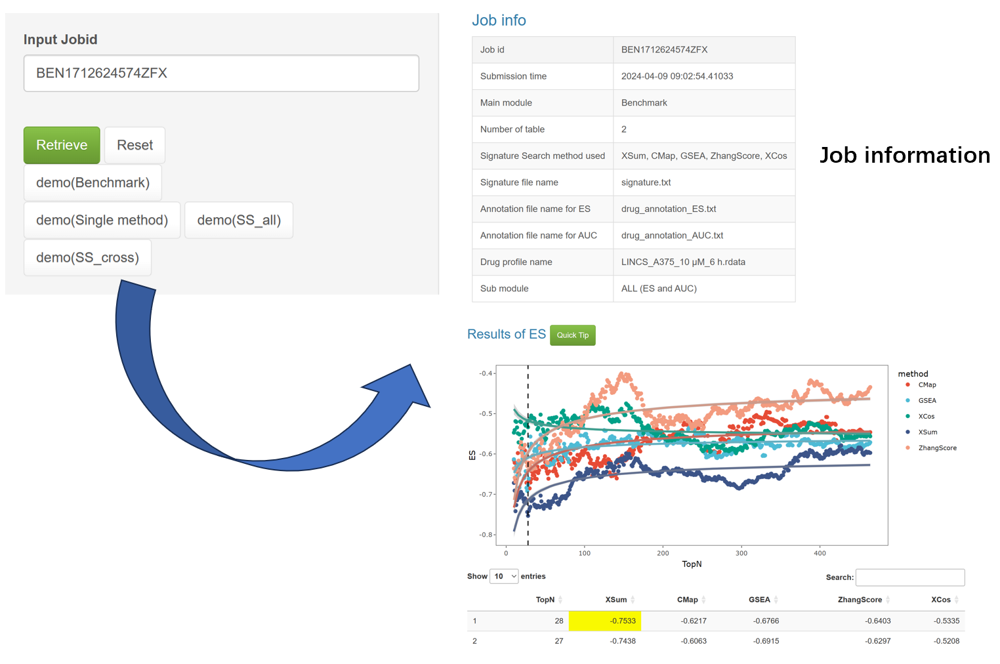

### How to get job result again?
To regain job results, please navigate to the job center page and enter your jobid.
It is important to note that there may be instances where your job is unsuccessful due to server-related issues.
In such cases, you need to resubmit your application.

**Bookmarkable result link.** When you submit a job, SSP2 shows a link of the form
`.../?job=<your jobid>`. Bookmark it: opening that link later automatically opens the
Job Center, loads the result (or shows the current queued / running / finished status), and
lets you retrieve it without typing the jobid again. The same link is shown in the Job
Center whenever a jobid is entered. Keep the link private - the jobid acts as the access
credential for your uploaded data and results.

