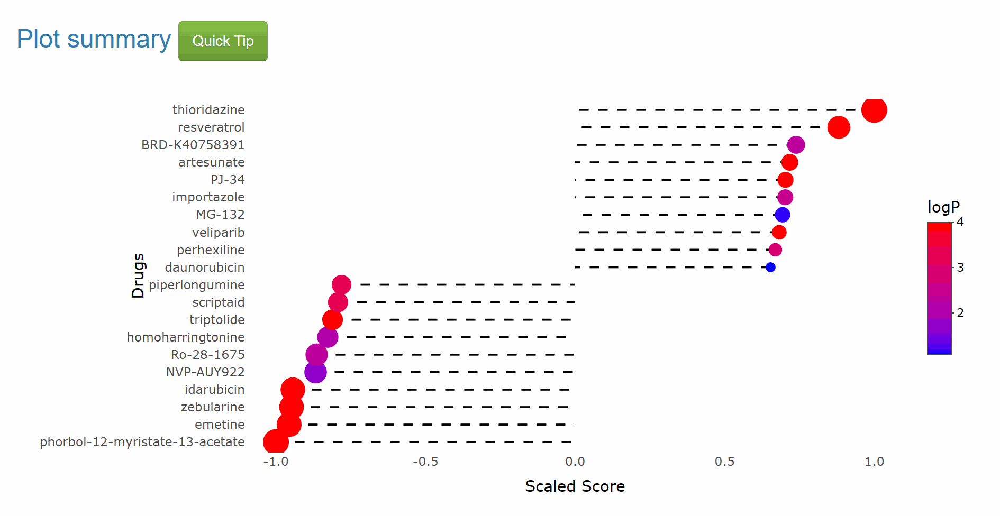
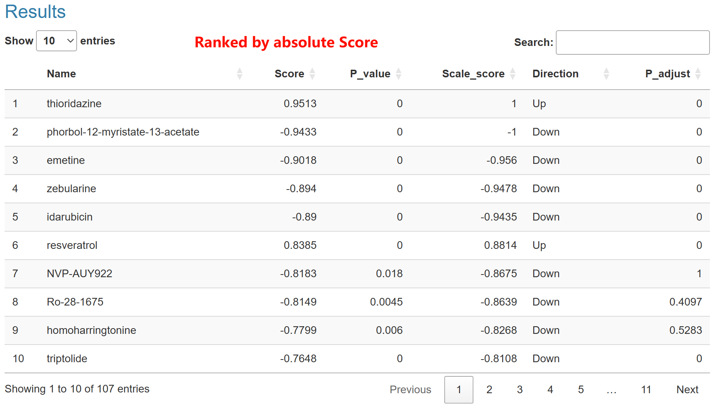

The single method is a classic drug repurposing method. One query signature and one signature search method (SSM) are required to retrieve drugs. 
In the single-method result, here is a lollipop with colored dots representing the Top10 drugs from the pharmacotranscriptomic dataset. For better readability, we use logP to color the dots.  

In the corresponding table below, Here are four columns:  
**Name**: Drug name in pharmacotranscriptomic dataset.     
**Score**: Score of drugs computed by SSM.
**Scale_score**:  Score are scaled from -1 to 1 for better comparison.  
**P_value**: p value of drugs computed by SSM using a null distribution. For every pharmacotranscriptomic dataset and SSM, we construct a corresponding null distribution by randomly sampling gene expression values and gene names from the pharmacotranscriptomic dataset data. This process is iterated to generate 2000 null signatures, which are then scored using corresponding SSM.
**P_adjust**: adjust p value of drugs computed by SSM. 
**Direction**: the drug show potential to input signature. In breif, <0 means "down" and >0 means "up".

Generally, Since SSP2 accepts input of query signatures, **drugs with score >0 may be agonistic to cancer, drugs with score <0 may be therapeutically beneficial against cancer.**    
Of note, table reordered the drugs by absolute value of Scores, rather than scaled scores, so that the top drugs may be sometimes polarized in up (>0) or down (<0). It is used when evaluate the overall response of signature. For example, if drugs of a specific pharmacotranscriptomic dataset response to the query signature with mainly positive scores, the concentration and treat time may be inappropriate for further investigation.  

