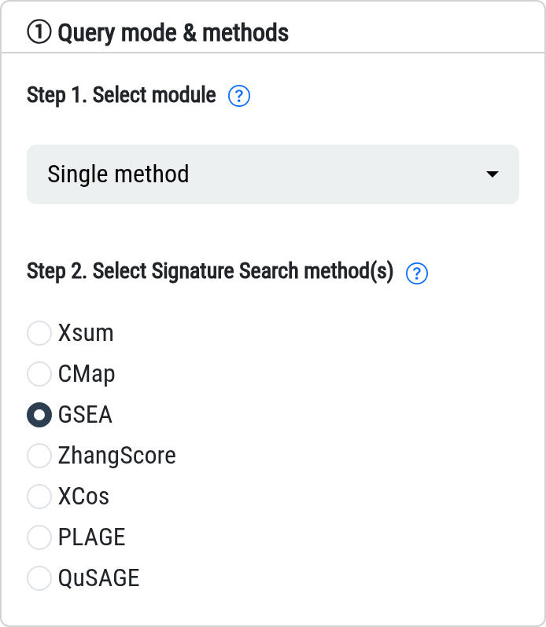
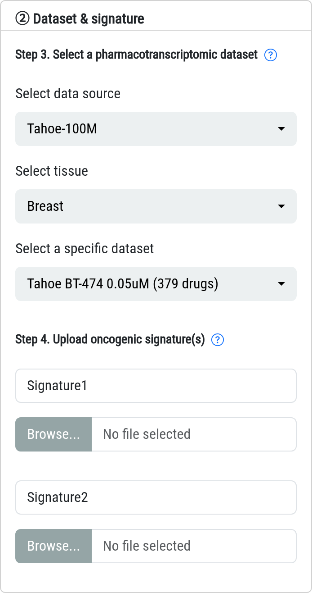
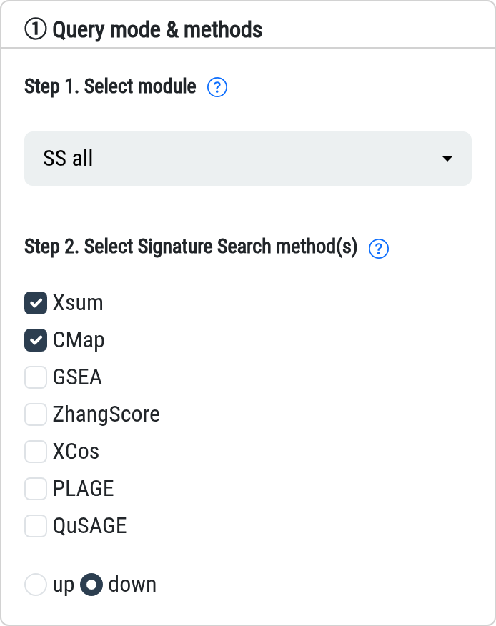
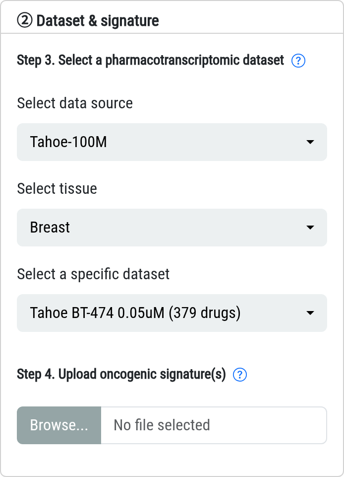
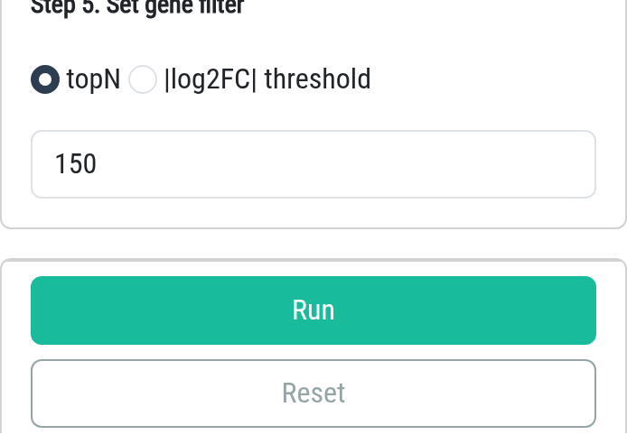

### Application: query promising drugs

In this module you apply signature-search methods (SSMs) to a pharmacotranscriptomic
dataset (PTD), and SSP2 ranks its drugs by how well they reverse your query signature.

**A query signature** is a two-column table with header `Gene` and `log2FC`. It is
usually built from the differentially expressed genes of cell / animal experiments or
patient cohorts (GEO, TCGA, ICGC ...). It should contain **at least 10 genes with
log2FC > 0 and 10 genes with log2FC < 0**, use gene symbols, and be
**statistically significant (adjust p-value < 0.05 or FDR < 0.05)**.

If your genes are given in another identifier format (EntrezID, Ensembl, UniProt,
Gene name ...), convert them in the **Converter** page first - only genes present in the
PTDs are used.

#### Three query modes

**1. Single method.** The conventional way: one signature, one SSM.

**2. SS_cross.** Your **two** signatures are queried together (optionally with two SSMs) and
the drugs are ranked by the summed score (Score~Sum~). Use it when two signatures should
agree, e.g. two datasets of the same cancer type; drugs ranked high in both are the
consistent hits.

**3. SS_all.** Drugs are queried with **several SSMs** and the rankings are aggregated with
Robust Rank Aggregation (RRA), which reports the greatest common drugs of all selected
methods. Select at least two methods - more methods mean longer runtime (a full selection
takes 20~40 min). For query signatures keep the direction **down**; other signature
types are not recommended.

#### Steps in the left panel

**Step 1.** Select the query mode (Single method / SS_cross / SS_all).

**Step 2.** Select the SSM(s): one for Single method and SS_cross, at least two for SS_all.

**Step 3.** Select the PTD - data source, tissue and a specific dataset (cell line, dose,
number of drugs). Datasets with more drugs and a tissue close to your cancer of interest
are usually a better choice.

**Step 4.** Upload the signature file(s). SS_cross asks for two signatures, and the name of
signature 1 labels the X-axis while signature 2 labels the Y-axis of the result figure.

**Step 5.** Set the gene filter: `topN` (default 150, guided by the Benchmark module) or a
|log2FC| threshold.

Then click **Run**. A job ID prefixed with `APP` is created; a full job usually takes
15~30 min and a **Quick Tip** appears with the result. You may close the page and fetch the
result later in the **Job Center** by its job ID.

For more information, please visit the **Info-Help** page.

**CRISPR KO datasets.** Choose data source `LINCS-CRISPR` to rank **target genes**
(knockouts) instead of drugs; drug-detail popups are disabled for these datasets. The
ranked entity is the knocked-out gene: negative scores indicate that its knockout reverses
your query signature (candidate target), positive scores indicate mimicry. See Help Q3 for
details and current limitations.
