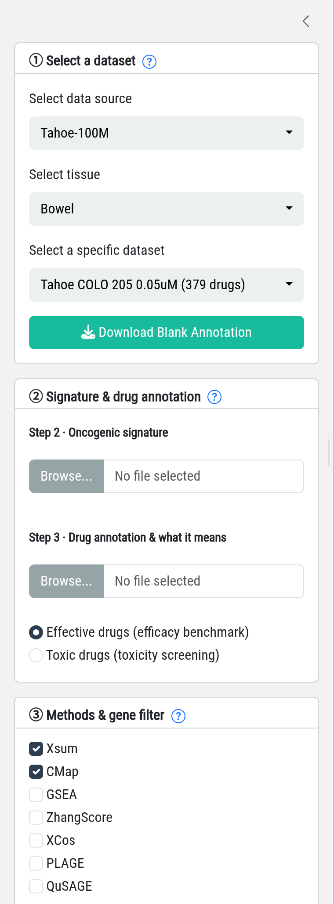
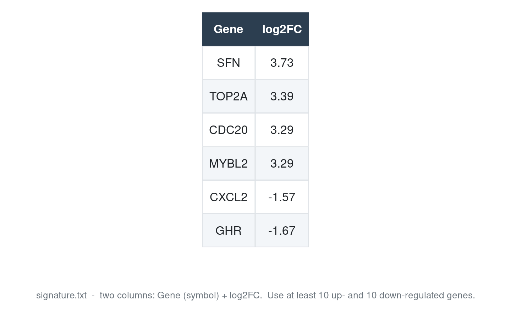
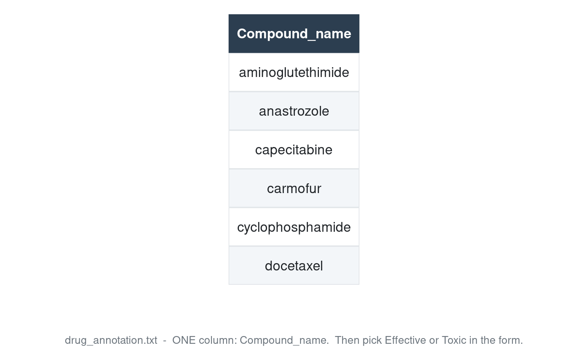
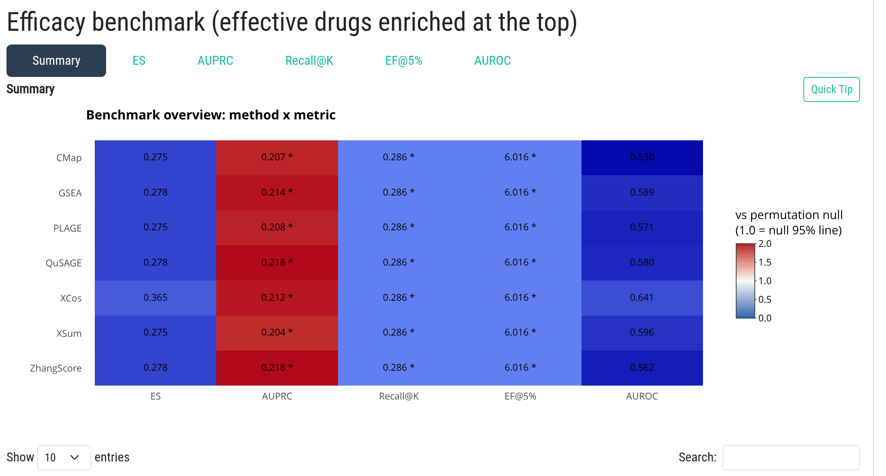
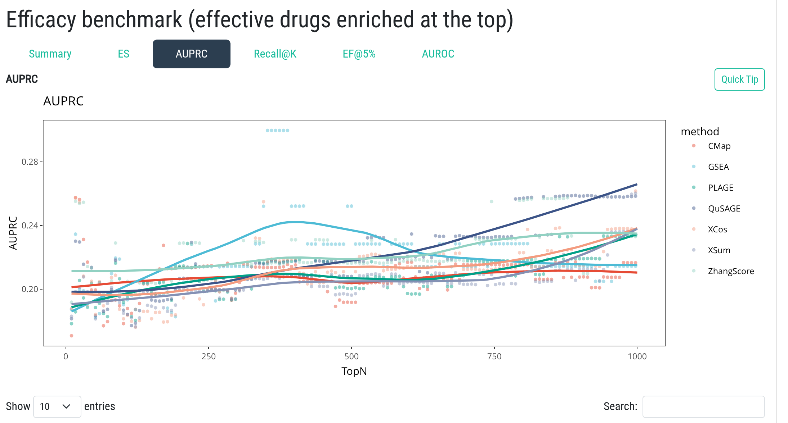

### Benchmark: evaluate signature-search methods

Upload **one oncogenic signature** (Gene + log2FC) and **one drug annotation list**
(a one-column drug list with header `Compound_name`), then compare how well the
seven signature-search methods (SSMs) retrieve your annotated drugs.

**Four inputs in the left panel**

**1. Dataset.** Pick a pharmacotranscriptomic dataset (source, tissue, cell line & dose).

**2. Oncogenic signature.** A two-column table (`Gene`, `log2FC`) with at least
10 up- and 10 down-regulated genes. A [demo signature file](demo/signature.txt) is provided.

**3. Drug annotation.** A one-column drug list, header `Compound_name`
(a [demo annotation](demo/drug_annotation_ES.txt) is provided). Then tell the platform
what these drugs mean:

- **Effective drugs** (*efficacy benchmark*) - the signature should rank these drugs at the
  **top**, e.g. drugs approved for the disease of interest.
- **Toxic drugs** (*toxicity screening*) - the signature should rank these drugs at the
  **bottom**; the metrics are then read as "your signature avoids toxic matches".

**4. Methods &amp; gene filter.** Select at least two SSMs and the gene filter mode.

**Results.** Click **Run** - a job ID prefixed with `BEN` is created and results appear in
the panel on the right (typically 15-30 min for a full method set). You may close the page
and retrieve the result later in the **Job Center**.

The **Summary** tab compares all methods across the five metrics; colour and `*` are
relative to the label-permutation null, so a red tile means "better than chance".

Each metric tab shows the full sweep curve and the matching table
(one column per method), so methods can be compared at any signature size.

Hover the **?** icons next to each step for detailed help.
