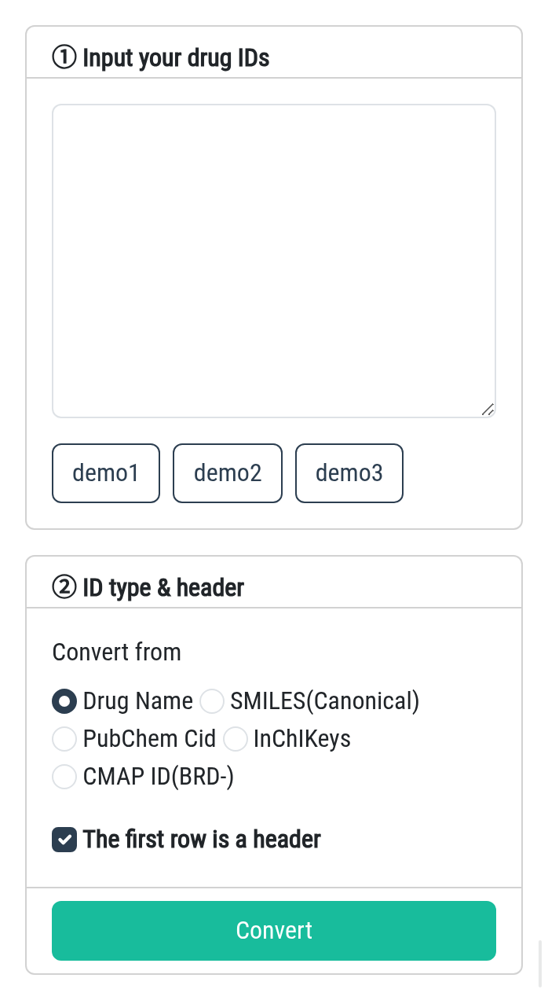

### Converter (for Drug)

SSP annotates drugs by **drug name** - the identifier of a drug in SSP is the
`Compound_name`. If your list uses another identifier (**SMILES(Canonical)**,
**PubChem Cid**, **InChIKeys** or **CMAP ID (BRD-)**), convert it here first: paste your
list in the left panel, choose the identifier type and click **Convert**; the converted
drug names are shown immediately on the right.

**Please note that the Converter module only returns drugs that are within the PTDs.**

Here are some tips:

1. The Converter accepts a drug list with **no more than 1000 rows**.
2. **SSP accepts a one-column list or a two-column tab-separated table.** The second column
   is kept in the output as `Group`, so an existing label (e.g. `Effective`) survives the
   conversion and can be used directly as the drug annotation in the Benchmark page.
3. If you input drug names and select **Drug Name**, SSP will try to correct the names
   **(capitalization and spaces)** to match the inner-built pharmacotranscriptomic datasets.
   This is very useful when the drug information was collected on your own.
4. The three **demo** buttons load an example list for each supported identifier type.

In addition, we also provide a gene converter; you can access the sub-module by clicking on
the **Gene** tab.
