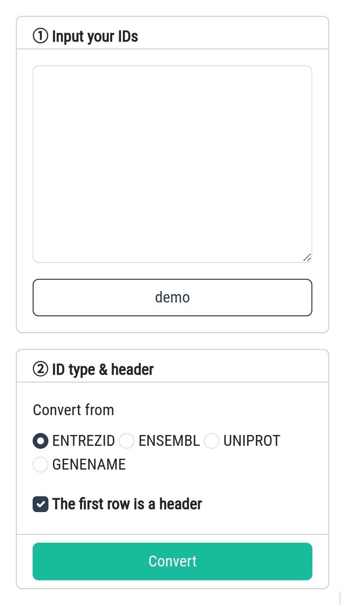

### Converter (for Gene)

SSP2 expects a two-column signature with header `Gene` and `log2FC`, and **the gene
identifier must be the gene symbol**. If your signature uses another identifier
(**ENTREZID**, **ENSEMBL**, **UNIPROT** or **GENENAME**), convert it here first - paste your
list in the left panel, choose the identifier type and click **Convert**; the result is
shown immediately on the right.

**Please note that the Converter module only returns genes that are within the PTDs.**
**In the current version, we have adopted the established practice of utilizing the 978 landmark genes from the LINCS L1000 database, as seen in prior research (PMID:28699633,35191375).**

Here are some tips:

1. The Converter accepts signature files with no more than **1000 rows**.
2. Only human **(Homo sapiens)** genes can be converted.
3. Paste a **two-column tab-separated table** (identifier + `log2FC`, header included). The
   `log2FC` column is kept in the output, so the converted signature can be uploaded
   directly to the Application / Benchmark pages.

In addition, we also provide a drug name converter; you can access the sub-module by
clicking on the **Drug** tab.
